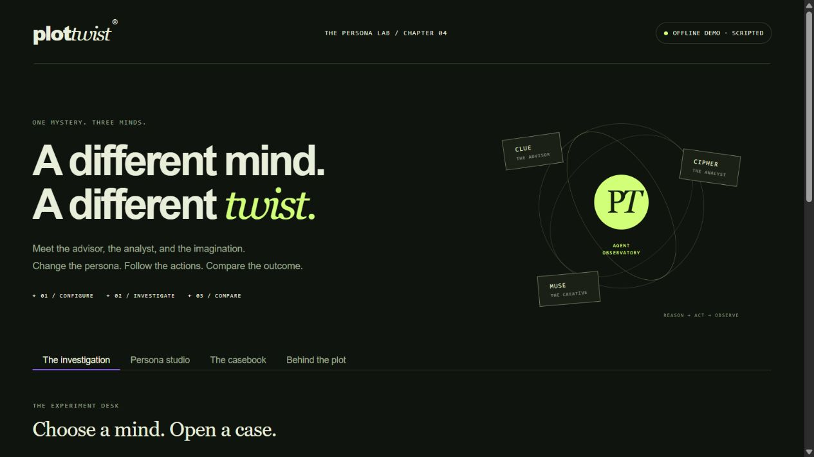

# PlotTwist Experiences

**Make a memory. Leave a mystery.**

**[Try the free hosted PlotTwist demo](https://huggingface.co/spaces/by-aseel/plottwist-free-demo)** — a browser-only Static Space. It uses scripted replies, browser-local enquiry/feedback records, and rule-based reflection. The full Python coursework projects support actual free local models as well as Gemini.

Two EECE 503P/798S coursework projects built around a fictional studio that creates personalized mystery experiences. The business team is **Aseel, Noah, Jiso, and Felix**; the names describe fictional business roles.

| Project | Implementation | Open |
|---|---|---|
| **C3 — Business Assistant** | Clue's persona and instructions, three-way routing, customer enquiry and feedback tools, conversation memory, and reflection | [README](c3_business_assistant/README.md) · [Notebook](c3_business_assistant/business_agent.ipynb) |
| **C4 — Persona Lab** | A manual LangGraph ReAct loop; Clue, Cipher, and Muse personas; configurable prompts and generation; an experiment runner and reflection | [README](c4_persona_lab/README.md) · [Notebook](c4_persona_lab/react_agent.ipynb) |

## Run an app

Use Python 3.11 or 3.12. Open the desired project folder and double-click `launch_demo.bat` on Windows. Alternatively, from that folder:

```powershell
python -m venv .venv
.\.venv\Scripts\python.exe -m pip install -r requirements.txt
.\.venv\Scripts\python.exe app.py --mode demo
```

C3 uses port **7860** and C4 uses **7861**. Keep the terminal running and open its printed local URL. Demo mode works without an API key and is explicitly labeled as a scripted offline demonstration. Each notebook is self-contained and can be uploaded alone to Colab.

For free real generation in either project, install Ollama, run `ollama pull qwen2.5:3b`, and launch with `--mode local`. No API key is needed. Gemini remains available with a privately configured key and restored access.

## Demonstrations and submission evidence

**[Current C3 English demo with actual free local-model generation](c3_business_assistant/docs/local_functionality_demo.mp4)** · [Measured C3 report](c3_business_assistant/docs/local_evaluation_report.md). This includes real model-requested tools, saved records and a clearly labeled controlled reflection correction.

**[Watch the 69-second working demo](media/PlotTwist-Quick-Demo.mp4)** — C3 and C4 replies, tool results, records, and persona comparison.

**[Watch the complete English walkthrough](media/PlotTwist-Complete-Walkthrough.mp4)** · [Video guide, transcripts, and subtitles](VIDEO_WALKTHROUGHS.md)

- **C3:** [full functionality video](c3_business_assistant/docs/functionality_walkthrough.mp4), [presentation script](c3_business_assistant/docs/demo_script.md), and [assignment checklist](c3_business_assistant/docs/assignment_checklist.md).
- **C4:** [full functionality video](c4_persona_lab/docs/functionality_walkthrough.mp4), [presentation script](c4_persona_lab/docs/demo_script.md), [assignment checklist](c4_persona_lab/docs/assignment_checklist.md), and [reflection](c4_persona_lab/docs/reflection.md).

The detailed videos are narrated, edited walkthroughs of actual offline UI captures and source explanations. They are not continuous recordings of live API calls. The earlier 32-second videos remain short previews. Current C3 actual local-model tools and reflection are documented in its new video/report. C4 actual local comparisons and the five measured reflection answers are included in its notebook.

## Verification

**27 C3 tests and 36 C4 tests passed.** The 10 C3 and 14 C4 offline notebook code cells were executed in order through IPython. The C4 demo report contains **238 deterministic runs**; these test workflow mechanics and do not establish a best LLM configuration.

From either installed project folder:

```powershell
.\.venv\Scripts\python.exe -m unittest discover -s tests -v
```

See [final preparation checks](FINAL_CHECKS.md), [C3 verification](c3_business_assistant/docs/verification.md), and [C4 verification](c4_persona_lab/docs/verification.md) for the scope and limits. Real Gemini attempts on 14 October 2026 failed with 403 project access denied; no successful Gemini answers are claimed; actual free local generation evidence is included in C3 and comparisons in C4. Native SDK integration, local tests and notebooks are complete. A free Static Space is now deployed; its source is in `deployment/huggingface-free/`. The Python/Gradio backend is not hosted by that Static demo.

## Business dossiers

[C3 dossier](c3_business_assistant/me/about_business.pdf) · [C4 dossier](c4_persona_lab/me/about_business.pdf)

The business, starting prices, and example contact details are fictional. Enquiry tools save local records; they do not send email or confirm bookings. Runtime databases, virtual environments, and real `.env` files are excluded from Git.



[Detailed start guide](START_HERE.md) · [MIT license](LICENSE)

## Gemini migration status

Both projects retain the official Google Gen AI SDK and support actual free local Ollama generation. Local mode uses Qwen2.5 3B; optional Gemini defaults to Gemini 3.5 Flash-Lite; the configuration matrix targets accessible Gemini 2.5 models when available. Current Google generation access is denied. C4 now has actual free local Qwen comparisons and a measured reflection; the native Gemini path remains available when access is restored. [Migration and exact rerun commands](c4_persona_lab/docs/gemini_migration.md) · [Failed real C3 attempt](c3_business_assistant/docs/live_access_attempt.json) · [Interrupted real C4 comparison](c4_persona_lab/experiments/live-access-check/comparison.md).

## Actual free local C4 evaluation

**252 initial model attempts + 14 parser-validation reruns**, using Qwen2.5 3B and 1.5B through the existing manual LangGraph graph. [Measured report](c4_persona_lab/docs/evaluation_report.md) · [Five reflection answers](c4_persona_lab/docs/reflection.md) · [Actual assistant-reviewed outputs](c4_persona_lab/experiments/local/assistant_ratings.csv) · [Install and run locally](c4_persona_lab/docs/local_models.md).

The study varies personas, prompt style/placement, examples, temperature, top-p, top-k, penalties, token limits and model size. It separates returned replies, tool success and factual quality, and retains failures. The subjective assistant review is clearly labeled. Earlier offline checks and videos remain distinct historical evidence; the free Static Space does not host these local models.


## Actual free C3 model evidence

[Current English functionality video](c3_business_assistant/docs/local_functionality_demo.mp4) · [Measured seven-case report](c3_business_assistant/docs/local_evaluation_report.md) · [Controlled reflection correction](c3_business_assistant/docs/local_reflection_challenge.json). C3 runs qwen2.5:3b through Ollama with no paid API key. The model requests the two real tools, observes their results and performs a second model review. The notebook displays this actual evidence separately from its default rehearsal. 27 C3 tests pass; the existing 36 C4 tests and measured study are retained. Full Python backend hosting on Hugging Face remains unavailable; the Static preview is separate.
