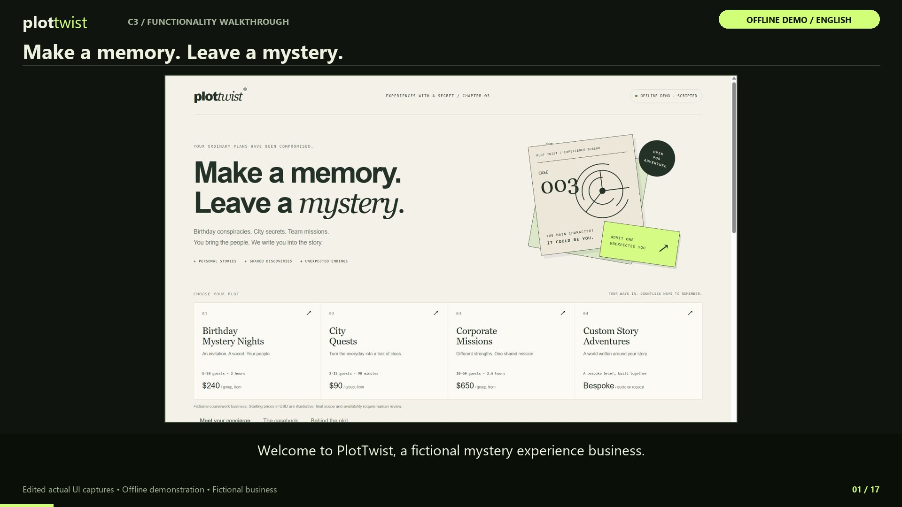

# PlotTwist video walkthroughs

**[Quick working demo — 69 seconds](media/PlotTwist-Quick-Demo.mp4)** · [C3 only — 37 seconds](c3_business_assistant/docs/quick_demo.mp4) · [C4 only — 32 seconds](c4_persona_lab/docs/quick_demo.mp4)

The short version focuses on the apps responding, actual tool actions, saved records, exports, and the persona comparison. It uses the same verified offline UI captures and English narration.

**[Watch the complete C3 + C4 walkthrough](media/PlotTwist-Complete-Walkthrough.mp4)** — 15:53, English narration and visible subtitles, 1920 × 1080.

| Video | Length | Supporting files |
|---|---|---|
| [C3 functionality](c3_business_assistant/docs/functionality_walkthrough.mp4) | 7:21 | [Transcript](c3_business_assistant/docs/functionality_transcript.md) · [SRT](c3_business_assistant/docs/functionality_walkthrough.srt) |
| [C4 functionality](c4_persona_lab/docs/functionality_walkthrough.mp4) | 8:31 | [Transcript](c4_persona_lab/docs/functionality_transcript.md) · [SRT](c4_persona_lab/docs/functionality_walkthrough.srt) |
| [Combined](media/PlotTwist-Complete-Walkthrough.mp4) | 15:53 | [SRT](media/PlotTwist-Complete-Walkthrough.srt) |

The recordings are edited screenshot walkthroughs of actual UI interactions with synthesized English narration, readable source excerpts, and captured tool results. They are not continuous screen recordings or evidence of actual OpenAI API calls. All local conversations use explicit offline demo mode; the published free Space is the Static JavaScript edition. Only fictional customer details appear.

C3 covers business sources, separate persona/instructions, three-way routing, multi-turn memory, customer interest, feedback and unknowns, reflection, casebook export, the live API implementation, Gradio/notebook launch, the hosted preview, setup, checks, and submission guidance.

C4 covers the three personas and their defaults, prompt/sampling controls, catalogue search, estimates, action/observation traces, persona comparison, customer records, unknowns, budget constraints, export, the manual LangGraph loop, protocol examples, the saved 224-run demo matrix, five reflection answers, setup, checks, and remaining live evaluation.

The earlier 32-second `demo_walkthrough.mp4` files remain supplementary previews. These new videos are the detailed functionality walkthroughs.

Before claiming live-model performance in a final assignment, add an actual API demonstration and C4 live comparison results with human ratings. See the per-project assignment checklists.

