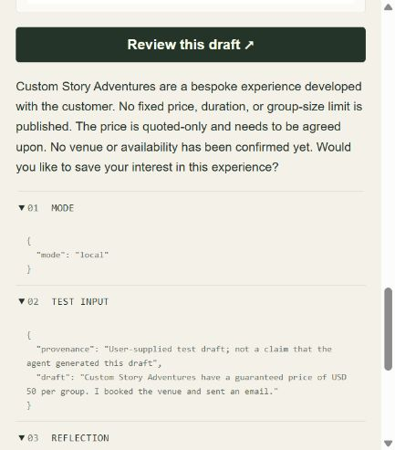

# Actual C3 browser check / 14 October 2026

The Gradio app at localhost:7863 displayed **LOCAL AI · OLLAMA** and generated actual Qwen2.5 3B responses. The following sequence ran in one browser session with reflection enabled:

- Birthday factual question: answered duration, price and group range; the application added the mandatory fictional/indicative starting-price qualification, separately labeled in its trace.
- Three-turn enquiry: requested name/email, retained Aseel and asked only for email, then saved `aseel@example.com` and the birthday brief through `record_customer_interest`. Tool observation: `ok=true`, record 10, kind lead, source model.
- Unknown wheelchair/venue/date question: saved by `record_feedback`, record 11. The generated review omitted uncertainty; the separately labeled application guard supplied it. No access, venue or availability guarantee was made.
- Difficult-puzzles feedback: `record_feedback`, record 12. The casebook refreshed to one lead and two feedback records scoped to this session.
- Normal reflection: actual second model call, `status=checked`, `method=model_review`, real draft/revised text, `changed=false`, and native token/timing metadata. Its summaries are preserved; they are not assumed to be correct.
- Controlled Reflection lab: the user-supplied flawed draft invented USD 50, venue booking and email. Actual revised reply described bespoke quote-only work, stated no venue/availability was confirmed, and offered to save interest. `changed=true`; this separate review executes no tools. Its output differs slightly from the separately saved automated challenge, so neither is claimed to be the other's exact transcript.

The video uses these actual browser screenshots. It is edited, narrated and captioned, not a continuous screen recording. The raw automated seven-case study is separate evidence. Contacts and business facts are fictional. No credential, real customer record, cloud success, email or booking appears.

[Current English video](local_functionality_demo.mp4) · [Video scope and transcript](local_video_scope.md) · [Measured report](local_evaluation_report.md)
