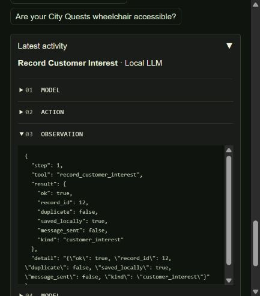

# Actual local-model interface check

On 14 October 2026 the Gradio app ran in explicit local mode at `http://127.0.0.1:7862`, using Qwen2.5 3B through Ollama and the custom LangGraph loop.

The browser showed **LOCAL AI · OLLAMA**. In a fresh browser conversation, Clue / direct / few-shot / system received a fictional Aseel enquiry. The model selected `record_customer_interest` with the exact supplied name and email. The real tool returned `ok: true`, `saved_locally: true`, `message_sent: false`, and record ID 12. The model then generated the final acknowledgement.

The separate [API callback check](local_gradio_check.json) exercised the team question, an enquiry in the same conversation, and all three persona comparison callbacks. It retained the actual generated outputs and trace HTML. That enquiry supplied an empty model-generated name and was rejected by validation; successful transport is therefore distinct from successful task completion. The fresh browser check above did save the record. Both outcomes are disclosed.

Only fictional test contact details were used. Records were saved in local SQLite; no email, external message or booking was made. This screenshot is proof of an actual local model/tool interaction, not a continuous video or evidence of cloud hosting.
