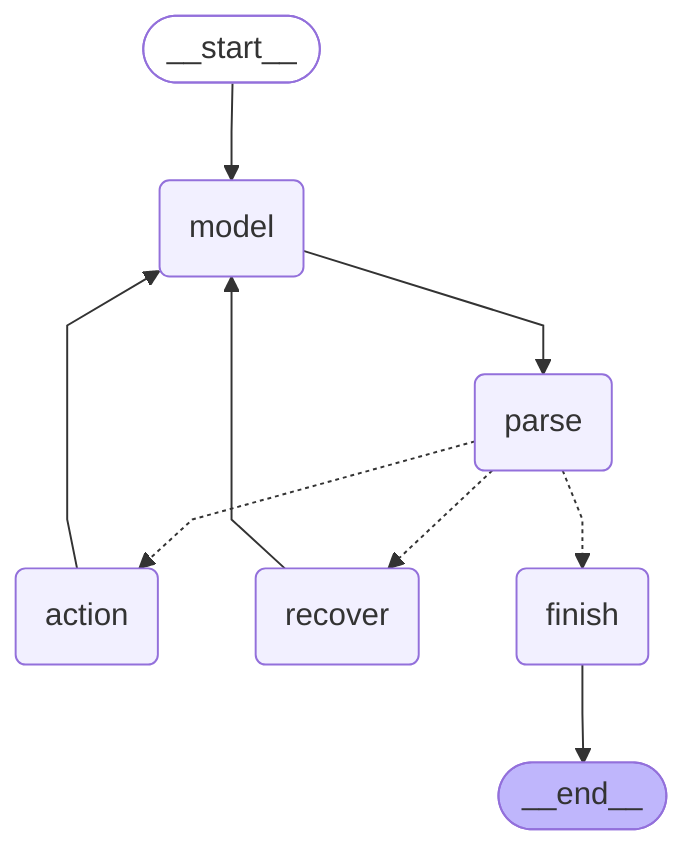

# Manual LangGraph ReAct workflow

The same graph runs the Gemini, real local Ollama and deterministic demonstration modes. Providers supply model text; the application owns action parsing, tool execution, observations, recovery and finalization. No prebuilt executor is used.

